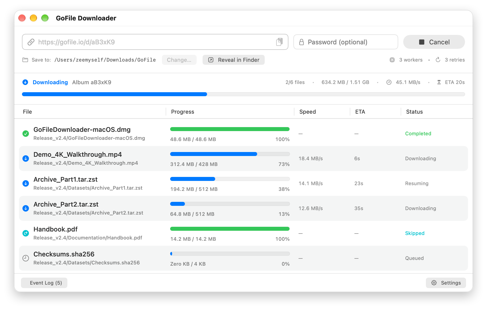
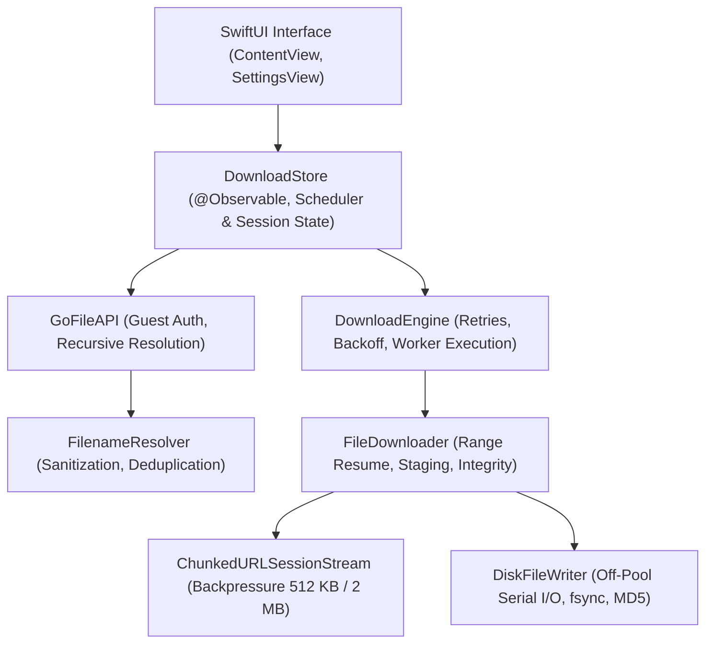

<div align="center">


# GoFile Downloader

**A fast, native macOS client for downloading files and nested albums from [GoFile](https://gofile.io).**

Built with Swift 6 and SwiftUI — featuring concurrent downloads, resumable chunked streaming, integrity verification, and zero third-party dependencies.

[](#requirements)
[](#requirements)
[](#features)
[](#building-from-source)
[](#architecture)
[](LICENSE)

[Features](#features) · [Building](#building-from-source) · [Usage](#usage) · [Architecture](#architecture) · [Security](#security--privacy) · [Testing](#testing) · [Contributing](#contributing) · [License](#license)

<br />

<picture>
  <source media="(prefers-color-scheme: dark)" srcset="docs/screenshot-dark.png" />
  <source media="(prefers-color-scheme: light)" srcset="docs/screenshot-light.png" />
  
</picture>

</div>

---

## Features

### Downloads & Album Resolution
- **Recursive Album & Folder Downloads** — Resolves GoFile links (`https://gofile.io/d/<id>`) or bare content IDs (`<id>`) and nested subfolders while preserving local directory structure, with built-in cycle, depth (`32` levels), and pagination (`100` pages) guards.
- **Password-Protected Links** — Supports password-protected GoFile albums (SHA-256 hashed client-side) and automatically highlights and focuses the password field when authentication is required or incorrect.
- **Concurrent Worker Pool & Smart Retries** — Downloads files in parallel with configurable concurrency (`1–8` workers) and per-file retries (`0–10`), using jittered exponential backoff with extended cooldowns for HTTP `421`, `429`, and `503` responses.
- **Automatic Deduplication & Skip Existing** — Resolves APFS case-insensitive filename collisions per folder by appending ` (1)`, ` (2)`, etc. before the extension, and automatically skips existing files whose size matches the expected remote size.

### Streaming, Resume & Integrity
- **Backpressure-Bounded Chunked Streaming** — Streams responses directly through a custom `URLSessionDataDelegate` adapter (`512 KB` / `2 MB` water marks) into dedicated off-pool serial disk writers (`DiskFileWriter`) with adaptive flush thresholds (`8 KB`–`512 KB`).
- **Safe Resumable Transfers** — Stages partial transfers inside an isolated `.gofile-partial/` directory using hash-scoped `.part` files and resume validators (`ETag` / `Last-Modified`), resuming via HTTP `Range` (`206 Partial Content`) with `If-Range` and strict `Content-Range` checks. Automatically rescues complete `.part` files or resets cleanly on `416 Range Not Satisfiable`.
- **Integrity Verification** — Enforces uncompressed transfer (`Accept-Encoding: identity`), checks exact byte lengths, validates MD5 checksums when provided by GoFile, flushes via `fsync`, and atomically promotes completed files into place.

### Native macOS Experience
- **Modern SwiftUI Interface** — Live per-file and aggregate progress bars, exponentially smoothed transfer speeds, ETA estimates, inline non-truncating status/error banners, and a resizable collapsible Event Log.
- **Quick Actions & Keyboard Shortcuts** — Multi-select row context menus, double-click to reveal in Finder, one-click clipboard paste, and standard macOS shortcuts (`Return`, `Esc`, `⌘,`).
- **Command-Line Automation** — Pre-fill URLs, passwords, and output directories or auto-start downloads via launch arguments.
- **Zero External Dependencies** — Written purely with Apple system frameworks (`SwiftUI`, `AppKit`, `Foundation`, `CryptoKit`, `Observation`).

---

## Requirements

| Requirement | Minimum Version |
| --- | --- |
| **macOS** | macOS 14.0 (Sonoma) or later (Apple Silicon or Intel) |
| **Xcode** | Xcode 16.0 or later (Swift 6.0) — required only to build from source |

---

## Building from Source

Clone the repository:

```bash
git clone https://github.com/zeemyself/GoFileDownloaderMac.git
cd GoFileDownloaderMac
```

### Build & Run in Xcode

1. Open `GoFileDownloader.xcodeproj` in Xcode.
2. Select the **GoFileDownloader** scheme.
3. Press **`⌘R`** to build and run.

### Build Universal Release via Command Line

```bash
xcodebuild \
  -project GoFileDownloader.xcodeproj \
  -scheme GoFileDownloader \
  -configuration Release \
  -destination 'generic/platform=macOS' \
  -derivedDataPath build \
  build
```

The resulting Universal (`arm64` + `x86_64`) app bundle is written to:

```text
build/Build/Products/Release/GoFileDownloader.app
```

Launch it directly from Terminal or copy it into `/Applications`:

```bash
open build/Build/Products/Release/GoFileDownloader.app
```

> [!NOTE]
> Local builds default to ad-hoc signing (`CODE_SIGN_IDENTITY="-"`) with **Hardened Runtime** enabled in Release and **App Sandbox** disabled, so no Apple Developer account is required to build locally. For signed distribution and notarization on other Macs, override `CODE_SIGN_IDENTITY`, `DEVELOPMENT_TEAM`, and `PRODUCT_BUNDLE_IDENTIFIER` on `xcodebuild`.

---

## Usage

### Quick Start

1. Paste a GoFile album URL (`https://gofile.io/d/<id>`) or bare content ID (`<id>`) into the URL field, or click the clipboard icon to paste. Bare IDs automatically expand to `https://gofile.io/d/<id>` when the download starts.
2. If the album is password-protected, enter the password in the optional password field.
3. Confirm or change the destination folder (defaults to `~/Downloads/GoFile`).
4. Click **Download** (or press `Return`).

Press `Esc` or click **Cancel** at any time to stop active transfers while preserving `.part` files for later resume.

### Keyboard Shortcuts & Row Actions

| Action / Shortcut | Behavior |
| --- | --- |
| `Return` | Start downloading the entered GoFile URL |
| `Esc` | Cancel active transfers (preserves `.part` files for resume) |
| `⌘,` | Open Settings |
| **Double-click row** | Reveal the downloaded file (or `.part` file / folder) in Finder |
| **Right-click row(s)** | **Retry / Resume**, **Re-download from Scratch**, **Reveal in Finder**, **Open File**, **Copy Filename(s)**, or **Copy Download Link(s)** |

### Settings

Open Settings via **`⌘,`** or the **Settings** button in the footer bar. Preferences are persisted automatically in `UserDefaults`.

| Setting | Default | Range | Description |
| --- | --- | --- | --- |
| **Download Folder** | `~/Downloads/GoFile` | Any directory | Base directory where album folders and files are saved |
| **Concurrent Downloads** | `3` | `1`–`8` | Maximum number of files downloaded in parallel |
| **Max Retries per File** | `3` | `0`–`10` | Automatic retry attempts per file with jittered backoff |

### Command-Line Launch Arguments

You can launch the app pre-configured from Terminal or scripts:

| Flag | Description |
| --- | --- |
| `--url <url or id>` | Pre-fill the GoFile album URL or bare content ID |
| `--password <password>` | Pre-fill the album password |
| `--output <path>` | Override the destination download folder |
| `--autostart` | Automatically start downloading after launch |

```bash
open build/Build/Products/Release/GoFileDownloader.app --args \
  --url "https://gofile.io/d/xxxxxx" \
  --output ~/Downloads/GoFile \
  --autostart
```

---

## Architecture



### Project Structure

```text
GoFileDownloader/
├── GoFileDownloaderApp.swift          # App entry point, scenes, and CLI launch arguments
├── ContentView.swift                  # Main window UI, file table, banners, context menus, event log
├── SettingsView.swift                 # Preferences view for folder, concurrency, and retries
├── DownloadStore.swift                # @Observable @MainActor state store, metrics, and queue scheduler
├── Formatters.swift                   # Byte count, transfer speed, ETA, and timestamp formatting
├── GoFileDownloader.entitlements      # App entitlements configuration
├── Assets.xcassets/                   # App icon and accent color
└── Core/
    ├── GoFileConfig.swift             # API constants, headers, defaults, limits, and adaptive chunk sizes
    ├── GoFileAPI.swift                # Guest token creation, website token signing, recursive resolution
    ├── FilenameResolver.swift         # APFS case-insensitive deduplication and UTF-8 component bounds
    ├── ChunkedURLSessionStream.swift  # Backpressure-bounded URLSessionDataDelegate chunk stream
    ├── DiskFileWriter.swift           # Off-pool serial disk writes, fsync, and cancellable MD5 hashing
    ├── FileDownloader.swift           # Streaming downloader with isolated .part staging and Range resume
    └── DownloadEngine.swift           # Concurrent TaskGroup runner and jittered exponential backoff

GoFileDownloaderTests/
├── Support/
│   └── MockURLProtocol.swift          # Lock-protected per-session URLProtocol mock
├── GoFileAPITests.swift               # URL parsing, token/password hashing, headers, chunk thresholds
├── FilenameResolverTests.swift        # Case-insensitive collision & UTF-8 truncation tests
├── ContentsParsingTests.swift         # Mocked resolution, password states, pagination & depth guards
├── FileDownloaderTests.swift          # Streaming, backpressure, resume, 416, MD5, symlink & staging tests
├── DownloadEngineTests.swift          # Concurrency limits, retries, backoff, and cancellation tests
├── DownloadStoreTests.swift           # Session lifecycle, errors, retry scheduling, and metrics tests
├── FormattersTests.swift              # Byte count, speed, ETA, and timestamp formatting tests
└── LiveSmokeTests.swift               # Opt-in live end-to-end GoFile API smoke test
```

---

## Security & Privacy

- **No Accounts or Telemetry** — Uses temporary GoFile guest tokens over ephemeral download sessions and sends no analytics, crash reports, or third-party network traffic.
- **Client-Side Hashing & Log Redaction** — Album passwords are SHA-256 hashed locally before being sent to the API. Query parameters, fragments, and credentials are stripped from URLs before appearing in errors or event logs.
- **Path & Symlink Hardening** — Untrusted remote filenames are sanitized against path traversal, control characters, Unicode bidirectional overrides, and overlong UTF-8 components. Every write target is verified with symlink-aware POSIX path resolution to remain strictly inside the destination directory.
- **Isolated Staging & Release Hardening** — Partial downloads are confined to `<destination>/.gofile-partial/` using hash-scoped filenames so remote names cannot collide with temporary files. Release builds enable Hardened Runtime and dead-code stripping.

---

## Testing

Tests are written with Apple's **Swift Testing** framework. All unit test suites run fully offline using a thread-safe per-session `MockURLProtocol`.

Run the test suite in Xcode (**`⌘U`**) or from the command line:

```bash
xcodebuild test \
  -project GoFileDownloader.xcodeproj \
  -scheme GoFileDownloader \
  -destination 'platform=macOS' \
  -derivedDataPath build
```

### Opt-In Live Smoke Tests

`LiveSmokeTests` makes live network requests against the GoFile API to verify end-to-end downloads and truncated `.part` resumption, and is skipped by default. Enable it with `GOFILE_LIVE_TESTS=1`:

```bash
GOFILE_LIVE_TESTS=1 xcodebuild test \
  -project GoFileDownloader.xcodeproj \
  -scheme GoFileDownloader \
  -destination 'platform=macOS' \
  -derivedDataPath build
```

| Environment Variable | Required | Description |
| --- | --- | --- |
| `GOFILE_LIVE_TESTS` | Yes (`1`) | Enables `LiveSmokeTests` |
| `GOFILE_LIVE_URL` | No | Custom GoFile album URL to test instead of the built-in fixtures |
| `GOFILE_LIVE_PASSWORD` | No | Optional password for `GOFILE_LIVE_URL` |

---

## Contributing

Contributions, bug reports, and feature suggestions are welcome!

1. Fork the repository and create a feature branch (`git checkout -b feat/your-change`).
2. Keep changes compatible with **Swift 6 strict concurrency** and zero third-party dependencies.
3. Add or update unit tests in `GoFileDownloaderTests/` and confirm `xcodebuild test` passes.
4. Open a pull request describing your changes.

For bugs or feature ideas, please open an issue on [GitHub Issues](https://github.com/zeemyself/GoFileDownloaderMac/issues).

---

## Disclaimer

This project is an independent, unofficial macOS client and is not affiliated with, endorsed by, or connected to GoFile.io. Please use it responsibly and respect GoFile's Terms of Service and applicable copyright laws.

---

## License

Copyright © 2026 [zeemyself](https://github.com/zeemyself).

Licensed under the **GNU General Public License v3.0 (GPL-3.0)** — see the [LICENSE](LICENSE) file for details.
